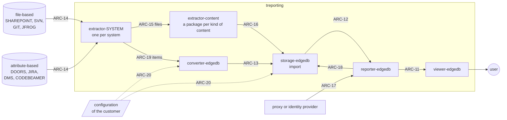

# System architecture (r3)

The subsystems of treporting, their interfaces, and which subsystems realize each system
requirement (r2).

There are two kinds of system:

- **file-based** systems - SHAREPOINT, SVN, GIT, JFROG - only manage files: the content lies in
  the folders and files themselves. extractor-content reads it, with a package for each kind of
  content and no plug-in mechanism.
- **attribute-based** systems - DOORS, JIRA, a DMS, CODEBEAMER - hold items whose attributes are
  customized by each customer. converter-edgedb maps those attributes to the model, by a
  configuration file of the customer.

Every system has an extractor of its own that lists and fetches what it holds. Both ways end in
the import of the storage, which works the same for every system. Each subsystem is a repo of
its own. r4 is not used: it would be a copy of r3 with object ids of its own, there only because
work is kept in different tools.

The terms - system, item, content, work product, release, library, baseline - are those of
[definitions.md](../definitions.md).

The ids are `ARC-nn`. The format of this file is preliminary until #6 defines it.

## Overview



## Subsystems

| Id | Subsystem | What it does |
|---|---|---|
| ARC-01 | viewer-edgedb | single page application: shows what the reporter answers - tables, charts, the trace - with filters, and hands tables and charts on |
| ARC-02 | reporter-edgedb | REST API: answers trace, states, maturity and compliance from one data set; takes the identity from the proxy or the identity provider and checks the role; records every report |
| ARC-03 | storage-edgedb | the model, the data sets and the `Source` interface over them - a database branch, generated data or a data file; the generator of data of known content; the import, the same for every system: counts what was stored, fingerprints it, derives the mapped (`M`) values by the configuration of the customer and the inherited (`I`) values, sets the state and keeps the import record; the audit trail |
| ARC-04 | converter-edgedb | maps the customized attributes of an attribute-based system to the model, by a configuration file of the customer; one general mechanism for all of them |
| ARC-05 | extractor-content | extracts the information the files of a file-based system hold - requirements, test cases, test results, annotations -, with a package for each kind of content and no plug-in mechanism. The package annotations reads `@implements` and `@verifies` from Go files; it is the repo reporter-annotations today |
| ARC-06 | extractor-SYSTEM | one per system, such as extractor-git or extractor-codebeamer: connects to it, lists and fetches what it holds with its identity in the system - revision, commit - and counts it by a query of its own |

## Interfaces

| Id | Interface | Between | Contract |
|---|---|---|---|
| ARC-11 | REST API | viewer → reporter | swagger of reporter-edgedb |
| ARC-12 | `Source` | reporter → storage | Go interface in storage-edgedb |
| ARC-13 | import | converter-edgedb, extractor-content → storage | Go interface in storage-edgedb |
| ARC-14 | system access | extractor-SYSTEM → system | per system: listing and fetching, and a query of its own for counting |
| ARC-15 | files | extractor-SYSTEM → extractor-content | a file with its kind and its identity in the system |
| ARC-16 | information | extractor-content → storage | the information extracted, per kind, over ARC-13; for annotations the format of #6 |
| ARC-17 | identity | proxy or identity provider → reporter | identity and groups of the user, handed on by the proxy or as a token (OIDC) |
| ARC-18 | audit trail | reporter → storage | Go interface in storage-edgedb |
| ARC-19 | items | extractor-SYSTEM → converter-edgedb | an item with its attributes as the system holds them, and its identity in the system |
| ARC-20 | configuration | customer → converter-edgedb, storage | the mapping of attributes and of values, one file per system of a customer |

## Decisions

### Independent count (SYS-23)

**Decision**: the source is counted by a query of its own (ARC-14), in the extractor of the system
but in code apart from the reader, and the stored count is taken from the storage after the import. A reader never
reports what it read as the count of the source. Besides, a verifier of its own, apart from all
subsystems, checks the data of treporting itself (the reference edgedb, #9) and is run on request,
for instance by an assessor; it is not delivered with the product.

**Example**: a CODEBEAMER tracker holds 1 200 requirements, read in pages of 500. A fault in the
paging drops the last page, so 1 000 are read. A reader that counts what it reads reports
1 000 in the source, 1 000 read, 1 000 stored - all equal, and wrong. The query of its own asks
for the total and gets 1 200; the difference of 200 marks the data set incomplete. On the other
side, two requirements share an id in the source: 1 200 are read, the second overwrites the first,
and only a count taken from the storage afterwards shows 1 199. In code, an `@implements` written
over two lines is missed by the reader and found by a plain `git grep -c '@implements'`.

**Why**: a count made by the reader shares every error of the reading, so it cannot find one. Only
a count on another way detects the errors of an import with high confidence - which is what tool
error detection TD1 asks for, and what keeps treporting at TCL1 without qualification (see
Integrity in the system requirements). The verifier goes one step further, independent of the
whole product; it costs a repo of its own, so it is kept for the own data and for the cases where
an assessor asks for it, rather than run on every import.

**Rejected**: the reader counting for itself - cheap, but it misses exactly the faults above.

### Import record (SYS-26, SYS-41)

**Decision**: the import of the storage brings the four counts together - the count of the
source from the extractor of the system, read and refused from extractor-content or
converter-edgedb, stored from the storage itself -, so it sets the state
of the data set - complete, incomplete, or unverified when the source has no count of its own - and
keeps the import record. The storage keeps the record with the data set,
the reporter hands the state on with every answer, the viewer shows it on every view.

**Example**:

```
import 2026-10-23T14:02:11Z  by m.fischer
  source        codebeamer, tracker 4711, revision 3812
  converter     converter-edgedb v1.4.0, configuration acme-codebeamer v7
  data set      release-2.1
  counted       requirement: source 1200, read 1000, refused 0, stored 1000
                link parentOf: source 3400, read 2890, refused 0, stored 2890
  refused       -
  fingerprints  1000 compared, 0 differ
  state         incomplete  (requirement -200, link parentOf -510)
```

**Why**: the record carries the trace of a report past the data set to the source and its
revision (REG-10), it is the audit trail of a change of data (REG-05), and it is the evidence that
errors of an import are detected (REG-01 to REG-03).

### Original and derived values (SYS-11)

**Decision**: the storage always keeps the original as read from the source. A value derived at
the import is never the original and is kept beside it under a name of its own, with a
prefix: `M` for a value mapped - translated or adapted to the model -, `I` for a value inherited
down the trace. When a rule changes, the derived values can be made again on the stored data set,
back in time, so that the data need not be fetched from the source systems again - a requirement
that follows from this architecture, not from a need (#19).

**Example**: the source says `Status = 'im Review'`; the import keeps it and adds
`MStatus = 'review'`, as the configuration of the customer maps it. A software requirement without a safety class under parents of ASIL B and
QM keeps `Safety` empty and gets `ISafety = 'ASIL B'`; its test case and test result get
`ISafety = 'ASIL B'` as well.

**Why**: what is stored can be compared with the source (SYS-25) and stays original (REG-10).
Where the evidence is that every requirement was classified by a person, the report shows
`Safety`, not `ISafety`; where the evidence is that nothing falls out of a filter, it shows
`ISafety`. A change of a rule needs no new import. Only a derived value that is stored can be
checked for plausibility - an original `Safety = 'QM'` under an `ISafety = 'ASIL D'` is a finding
(#19).

**Rejected**:

- the reporter derives the values when it answers, and nothing derived is stored. It keeps the
  rule in one place and the storage plain, but a derived value then exists only in an answer:
  it cannot be checked for plausibility, compared between two reports, or shown to an auditor
  as what the report was made from.
- the storage derives them in a view of the database. It binds the rule to the database, and the
  data file (SYS-21) would need the rule a second time.

### Configuration instead of code for the customer (SYS-22)

**Decision**: what differs from customer to customer - the customized attributes of an
attribute-based system and the values to be mapped - is a configuration file, read by one
general mechanism: converter-edgedb for the attributes, the import of the storage for the
values. Only what a configuration cannot say goes into code of its own, in a private repo per
system and customer, such as converter-doors-acme.

**Example**: one customer keeps the safety class of a requirement in the DOORS attribute
`ASIL_Rating`, another in `Safety Level`, with the values `QM, A, B, C, D` or `none, ASIL A, ...`.
Two configuration files map both to `Safety` and their values to `MSafety`; the code is the same.

**Why**: the formats of a customer are proprietary and must not reach the public repos. A
configuration stays with the customer; the mechanism stays public and is tested once for all.

**Rejected**: a converter in code per system - the proprietary formats would be in code, and the
same mechanics would be written once per system.

### Identity (SYS-39) - provisional, confirmed or changed by #22

**Decision**: treporting keeps no users and no passwords of its own. It takes the identity from
what the organization already has: preferably from a proxy in front of it that authenticates the
user and hands the identity and the groups on - transparent, treporting needs no logic of its
own for it -, and where possible from the identity provider of the organization over a standard
protocol (OIDC). The organization maps its groups to the roles of treporting by configuration.

**Example**: a supplier runs treporting in its own network; its people log in everywhere with
their company account. When someone leaves, the one account is locked, and treporting is closed
to them at the same moment - there is nothing to lock in treporting.

**Why**: we do not know how others manage their users, so treporting fits into what is there
instead of bringing a second management. A proxy keeps that entirely outside treporting.

**Rejected**: a user management of its own in treporting - a second place to lock an account,
and the duty of keeping passwords.

**To be settled by #22**: with a proxy, the reporter must be reachable only through it, or the
handed-on identity can be forged; and how a single user works locally without a proxy and without
an identity provider (UN-OPS-01), with reports marked as made without login.

## Allocation

V viewer, R reporter, S storage, C converter-edgedb, EC extractor-content, ES extractor-SYSTEM.

| Id | V | R | S | C | EC | ES |
|---|---|---|---|---|---|---|
| SYS-01 | x | x | | | | |
| SYS-02 | x | x | | x | x | |
| SYS-03 | x | x | | | | |
| SYS-04 | x | x | | | | |
| SYS-05 | x | x | | | | |
| SYS-06 | x | x | | | | |
| SYS-07 | x | x | | x | x | |
| SYS-08 | x | x | | x | x | |
| SYS-09 | x | x | | | | |
| SYS-10 | x | x | | | | |
| SYS-11 | | x | x | | | |
| SYS-12 | x | x | | x | x | |
| SYS-13 | x | x | x | | | |
| SYS-14 | x | x | x | | | |
| SYS-15 | x | x | | x | x | x |
| SYS-16 | x | x | x | | | |
| SYS-17 | x | x | | x | x | x |
| SYS-18 | x | x | x | | | |
| SYS-19 | | x | x | | | |
| SYS-20 | | x | x | | | |
| SYS-21 | | | x | | | |
| SYS-22 | | | x | x | x | x |
| SYS-23 | | | x | x | x | x |
| SYS-24 | | | x | x | x | x |
| SYS-25 | | | x | x | | |
| SYS-26 | x | x | x | | | |
| SYS-27 | x | x | x | x | x | x |
| SYS-28 | x | x | x | x | x | |
| SYS-29 | x | x | | | | |
| SYS-30 | x | x | | | | |
| SYS-31 | x | x | | | | |
| SYS-32 | | x | x | | | |
| SYS-33 | x | | | | | |
| SYS-34 | x | x | | | | |
| SYS-35 | x | x | x | x | x | x |
| SYS-36 | | | x | | | |
| SYS-37 | x | x | | | | |
| SYS-38 | x | x | x | x | x | x |
| SYS-39 | x | x | | | | |
| SYS-40 | | x | x | | | |
| SYS-41 | | | x | | | |
| SYS-42 | | | x | | | |
| SYS-43 | | x | x | | | |
| SYS-44 | | x | x | | | |
| SYS-45 | | x | | | | |
| SYS-46 | | x | | | | |
| SYS-47 | | x | | | | |
| SYS-48 | | x | | | | |
| SYS-49 | | x | x | | | |
| SYS-50 | | x | | | | |
| SYS-51 | | x | x | | | |
| SYS-52 | x | x | x | | | |
| SYS-53 | | | x | x | x | x |
| SYS-54 | | x | x | | | |
| SYS-55 | x | x | x | x | x | x |
| SYS-56 | | x | | | | |
| SYS-57 | x | | | | | |

## Open

- **Repos**: reporter-annotations becomes the package annotations of extractor-content; the repos
  of extractor-content and of the extractors per system are not created yet.
- **Generator**: the data of known content for SYS-27 is made by the generator in storage; the
  faults built into it are listed by #12.
